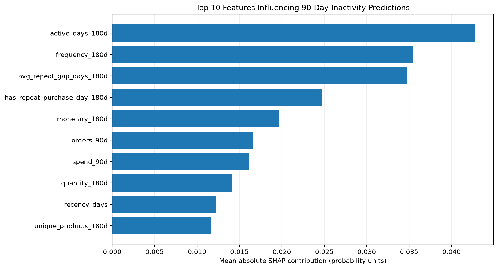
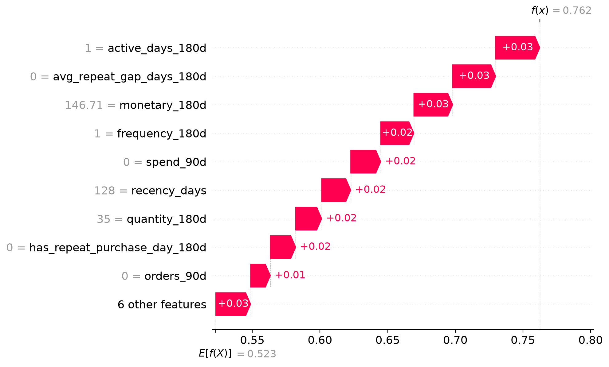

# SHAP Explainable AI Analysis

## Objective

Explain predictions from the frozen Random Forest
customer inactivity classification model.

## Configuration

- Model: Frozen Random Forest
- Features: 15
- Training snapshots: 14,987
- Explained sample: 100 training snapshots
- SHAP version: 0.53.0
- Method: TreeExplainer
- Output: Probability contributions for class 1
- Held-out test data not used for explanations

## Top 5 Features

| Rank | Feature | Mean Absolute SHAP |
|---|---|---:|
| 1 | active_days_180d | 0.042799 |
| 2 | frequency_180d | 0.035484 |
| 3 | avg_repeat_gap_days_180d | 0.034738 |
| 4 | has_repeat_purchase_day_180d | 0.024698 |
| 5 | monetary_180d | 0.019597 |

These rankings are based on 100 sampled
training snapshots, not the entire population.

## Individual Prediction

- Base inactivity probability: 0.523025
- Example predicted probability: 0.762440
- Net SHAP contribution: +0.239415
- Maximum additivity error: approximately zero

The SHAP contributions reconstruct
the model's predicted probability.

## Visualizations

### Global Feature Importance

### Individual Waterfall Explanation

## Interpretation

Historical purchase activity and repeat
purchase behavior were influential model
inputs in the sampled observations.

SHAP explains model predictions but does not
establish why a customer became inactive.

## Limitations

- Only 100 training snapshots were explained.
- SHAP values are not causal effects.
- Model explanations depend on the fitted model.
- Customer inactivity does not necessarily
  represent permanent churn.
- The held-out test was not reused to
  select or optimize the model.

## Conclusion

SHAP improves transparency by showing
which customer behavior features influence
the frozen model's inactivity risk predictions.
